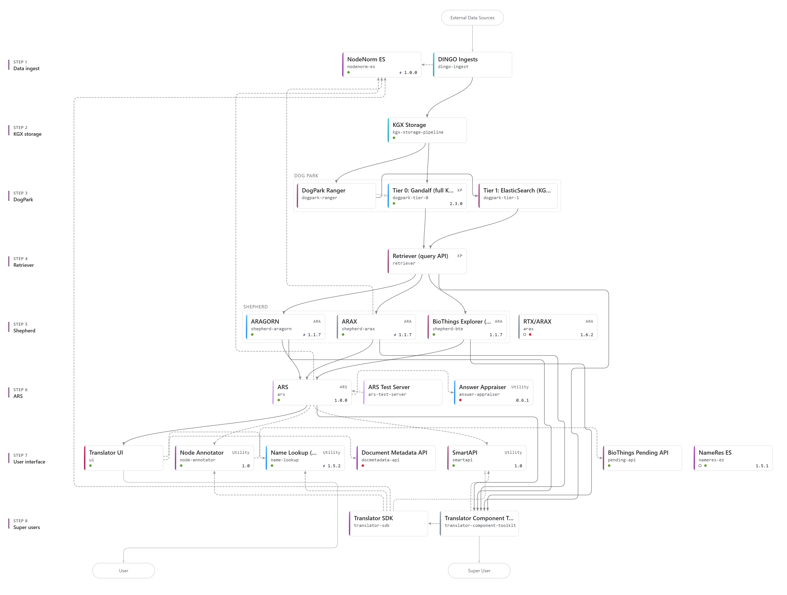

# Reasoner Validator - The Next Generation

## Overview

As in the Development Phase 2, Translator remains upon a foundation of adopted
community standards: [Translator Reasoner API ("TRAPI")](https://github.com/NCATSTranslator/ReasonerAPI), 
the [Biolink Model](https://github.com/biolink/biolink-model), knowledge source indexing within
a unified [Information Resource Registry ("Infores") catalog](https://github.com/biolink/information-resource-registry),
shared public ontology, shared libraries and related artifacts.

The reasoner-validator package developed during earlier phases of the project, is routinely 
revised to meet the ongoing evolution of these standards, in particular, TRAPI and the Biolink Model. As of this date
(November 4, 2026), TRAPI is now into a beta of major release 2.0, while the Biolink Model is now into release 4.4.6.
The reasoner-validator is being iteratively refined to assess compliance of TRAPI query requests and responses
to these latest standards.

The refactoring of the Biomedical Data Translator code base in the Performance Phase 3, has given rise to a
novel architecture (see diagram at the bottom of the page). TRAPI validation is currently undertaken at 
various TRAPI flow points with and without the reasoner-validator (for example, using the
[TRAPI Object Models](https://github.com/NCATSTranslator/TRAPIObjectModeling)).

It now seems appropriate to take a fresh look the scope and requirements of standards validation within the
Phase 3 architecture, as well as, consider possible consolidation of validation approaches and code
underneath a single shared framework.

A systematic sequence of steps to achieve this are envisioned:

1. Solicit feedback from all teams developing Phase 3 Translator platform components to compile an inventory of current TRAPI validation currently being done (i.e., as summarized in the table like that in the next section)..
2. Review current validation processes, consolidate current and additional (gap-filling) use cases and functional requirements for validation.
3. Review current validation scripts and associated libraries (i.e., TOM, reasoner-validator, ...) against the consolidated inventory of use cases and functional requirements.
4. Design and implement an agile collaborative strategy to iteratively harmonize and/or merge the extant validation software towards a single Phase 3 validation platform.
5. Deploy the validation platform, where indicated, within the Phase 3 platform

# Current Inventory of TRAPI Validation of Translator Components

The following is a table of known TRAPI validation control points within the above architecture (to be completed by feedback from Translator component teams).

| Component | Validation Tool     |
| --------- |:-------------------:| 
| ARAX      | reasoner-validator  | 
| Retriever | TRAPIObjectModeling |
| Other(?)  | Other(?)            |

## Phase 3 Architecture

Snapshot of [Translator Diagram](https://ncatstranslator.github.io/translator-diagram/?view=map) accessed November 4, 2026.

